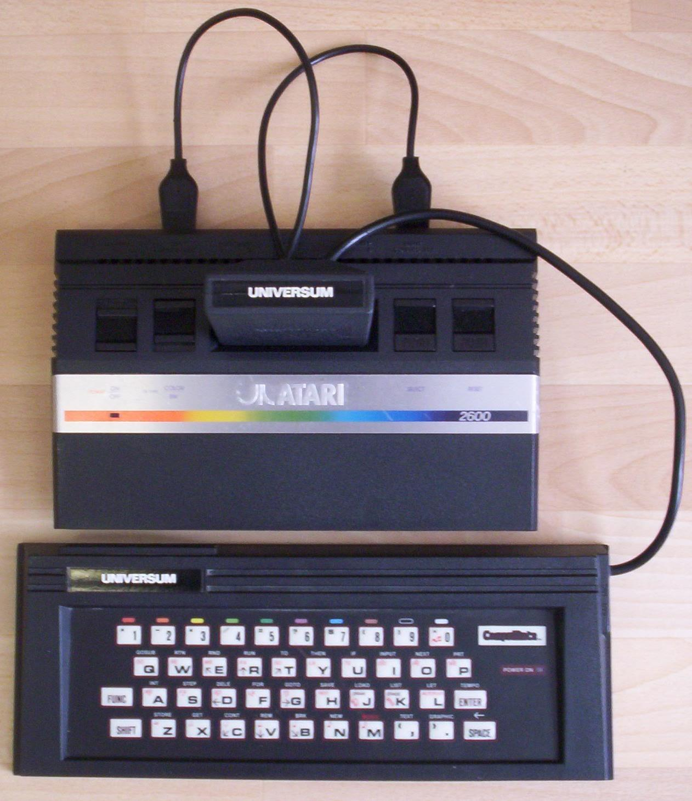

## About


```
You can discover more about a person in an hour of play than a year of conversation.
                                                                        --- Plato
```

I was five years old when I got my very first computer. Or rather an Atari 2600 console, and something called Universum Compumate. It was a the keyboard through its cartridge-bay it became a fully functional personal computer. It came with cartridges, utterly non-ergonomic joysticks and the keyboard, which had a cartridge-shaped plug.

After I played all the games and all the levels and cheated all the way in the game with the spaceship and pipes I attached the keyboard.

I barely was six years old when my father and I borrowed a book for Atari with full of little programs you could type in yourself.

So we did that. Together. It was rare that he had the time to sit down with me to play and generally do stuff together, so these sessions were prime-time for me.

Probably this association played a big role when I started to sink in with my curious mind into the world of programming. First, just with the type the program in from a book or magazine, then search the bugs I made during the typing, where I missed a line or typed it twice and so on and so forth.

It was a great training to find bugs later. But after a while I started to tinker with them and eventually I arrived to a whole new level. I started to write my own things.


Source: [Superandi73](https://commons.wikimedia.org/wiki/File:Atari_2600_Compumate.jpg)

I was eleven when I dipped my toe into the world of Assembly, but it was already on a precious Commodore 64. I still own that machine in the attic of my parent’s house.

Writing small demo programs, counting vertical synchronization on the CRT monitor, using low-level services like IRQs taught me very well.

Of course when the time came to choose what I want to be when I grow up, it was only one choice, so I went to a specialized high school to graduate and get certification for programming. They bundled it with economics and accountant-work, so I had to take those too. But later in life it became convenient when after college I started to work in the enterprise business.

But why games? Well, the very first thing I started to write by myself was an Invaders-clone in C64 Basic. It was famous in the entire household. Yes, this means I liked it and my father said he likes it too, he just was this way, he always found the way he can encourage me when it counted.

Making games always was part of my life, if not computer games, then table-tops or board games. Or even, okay it was just one time, part of a team to write a pen-and-paper role-playing game.

A couple of years ago I started to play with the thought again to take it up so I downloaded Unity and later Unreal Engine so I just started.

Now I’m part of the community and trying to give back all the help I got when I started.

I hope you will enjoy what I have to offer, but I expect from you your opinion regardless.

Keep on gaming, my friend and build your own games too!

[back](./)
